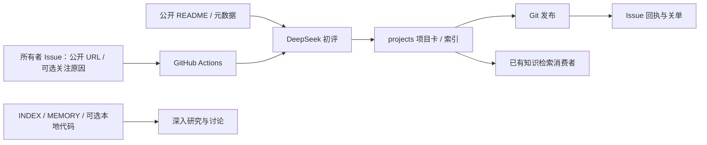

# GitHub Knowledge Base

公开 GitHub 项目的选型目录。保留本地目录/笔记，同时提供所有者 Issue → GitHub Actions → DeepSeek 初评 → 项目卡与回执的入口。初评不代表已经试用或采用。

## 两条使用路径

| 目的 | 入口与产物 |
|---|---|
| 收藏一个公开项目做初评 | 创建 [Add project Issue](https://github.com/zhiweiofli/github-kb/issues/new?template=add-project.yml)，标题以 `[Index]` 开头；Action 生成 `projects/<owner>--<repo>.md` 与索引，发布成功后回贴并关闭 Issue |
| 查找自动项目卡 | [projects/INDEX](projects/INDEX.md)，卡片保留来源 Issue、README 版本与评估信息 |
| 检索旧目录与讨论结论 | [INDEX](INDEX.md) · [MEMORY](MEMORY.md) · [FOCUS](FOCUS.md)，不自动迁移历史记录 |
| 本地深入读代码 | 按需用 gh/本地文件工具；`repos/` 中 clone 是可选行为，不是初评入口的运行依赖 |
| 失败或重复处理 | 查看对应 Action；需要重试时在 Run workflow 输入 Issue number，具体行为以当前脚本为准 |

## 项目与技术地图

| 文件 | 职责 |
|---|---|
| [.github/workflows/index-project.yml](.github/workflows/index-project.yml) | 所有者与入口检查、模型运行、Git 发布和 Issue 回执；可手动重试 |
| [.github/ISSUE_TEMPLATE/add-project.yml](.github/ISSUE_TEMPLATE/add-project.yml) | 项目 URL 与可选关注原因 |
| [scripts/index_project.py](scripts/index_project.py) | 读取 README/元数据、模型请求与结构验证、项目卡/索引生成 |
| `projects/` | 自动项目卡及目录；保持与旧 INDEX/MEMORY 分开 |
| [CLAUDE](CLAUDE.md) | 历史本地检索/目录工作流入口；不代表自动初评必须 clone |
| [原 ADR](docs/ADR-001-architecture.md) | 已接受的本地文件系统初始设计与边界 |
| [Actions 接入记录](docs/deepseek-action-acceptance.md) | 本地实现证据、历史状态与最新只读运行核对 |

workflow 的默认模型兼容名为 `deepseek-v4-flash`，可由仓库变量 `DEEPSEEK_MODEL` 覆盖；API key 由 Actions Secret 提供。按现有 workflow 成功发布后关单，失败保持开放并贴运行链接。本轮没有新增运行、写入凭据或改变权限。

## 发布与检索边界

- 本仓库公开；公开 README/元数据及 Issue 的关注原因会发送给模型并成为公开产物，不上传私有画像。
- 项目卡是本仓库的真值，PWR 等消费者可以构建派生检索；默认留作选型目录，不因初评自动变成近期关注或长期概念。
- 上游采集仓转交公开 GitHub URL 的 Action 是另一入口；本文不据本仓库运行成功宣称其全部转交路径已验收。
- 初评不等于代码审计、实际使用或性能验证；Git 合并/发布也不等于外部索引已更新。

## 最新核对

2026-10-02 只读核对：远端 main `499faa3568646fbd4fcb819e685f6bf48e0dffed`，最近三次 `index-project.yml` 运行均 completed/success，发生于 2026-09-28。运行元数据证明已有真实成功记录，本轮未重读全部模型响应、逐卡质量或重复提交路径。

本地 checkout 为 `d2283a8`，与远端分开；本轮只整理文档，没有 pull/commit/push，也未启用或修改调度。当前初评行为以对应版本的脚本和 workflow 为准。
